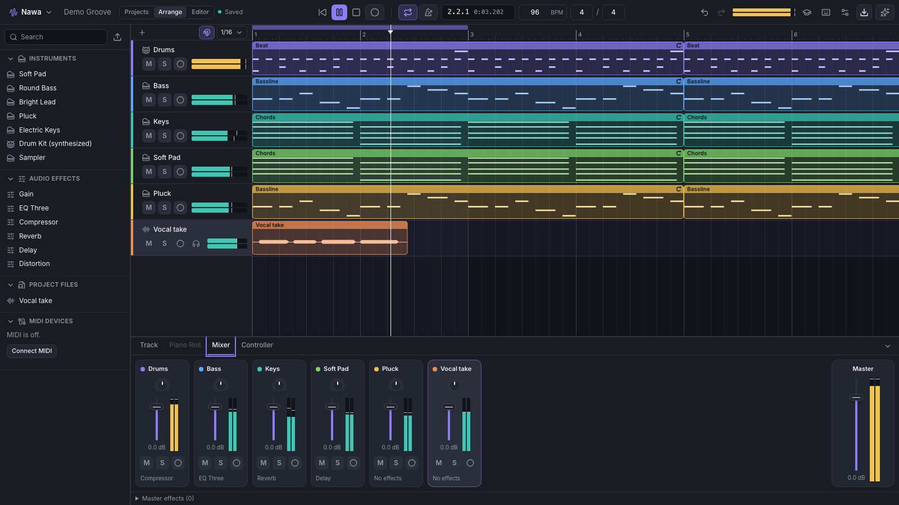

<div align="center">

# Nawa

**A local-first music studio that runs in your browser.** Arrange, play MIDI instruments,
record, mix and correct vocal pitch, with no account, no subscription and no server.

[](https://github.com/itsdula/nawa/actions/workflows/ci.yml)
[](https://github.com/itsdula/nawa/actions/workflows/pages.yml)
[](https://github.com/itsdula/nawa/releases)

[**Website**](https://itsdula.github.io/nawa/) ·
[**Open Nawa in your browser**](https://itsdula.github.io/nawa/studio/) ·
[Download](https://github.com/itsdula/nawa/releases) ·
[Docs](docs/architecture.md)



</div>

## Contents

- [Features](#features)
- [Download](#download)
- [Browser support](#browser-support)
- [Quick start](#quick-start)
- [Scripts](#scripts)
- [Project structure](#project-structure)
- [Testing and quality gate](#testing-and-quality-gate)
- [Releasing](#releasing)
- [Architecture](#architecture)
- [Documentation](#documentation)
- [Contributing](#contributing)
- [Licence](#licence)

## Features

- **Arrangement.** Multitrack timeline with MIDI and audio clips, loops, snapping, undo/redo
  and autosave.
- **Instruments.** Built-in synths (pads, bass, leads, plucks, electric keys), a synthesized
  drum kit and a sampler, played from the on-screen keyboard or any Web MIDI controller.
- **Piano roll and editor.** Draw, select, quantize and edit notes in a docked piano roll or a
  full-height editor.
- **Recording.** Record audio from a microphone or interface with adjustable latency
  compensation, and record MIDI performances.
- **Mixer and effects.** Per-track volume, pan, mute, solo and meters; gain, three-band EQ,
  compressor, reverb, delay and distortion; WAV export with an offline render.
- **Vocal pitch editor.** Detects every sung note (pYIN), estimates the key and corrects pitch
  with TD-PSOLA.
- **AKAI Professional MPK Mini MK3.** A researched device profile, an interactive hardware view
  and MIDI Learn. Tested against a simulated Web MIDI port only, not yet on a physical unit
  ([compatibility matrix](docs/midi-device-research.md)).
- **Guided tutorials and sample projects.** Interactive tours and 30 sample songs across EDM,
  house, pop, rap, rock and techno.
- **Local-first.** Projects and audio stay in your browser's IndexedDB. Export and import
  portable project bundles.

The AI assistant built into the Studio needs a model endpoint. The website is static, so the
assistant is unavailable there; see [docs/assistant.md](docs/assistant.md).

## Download

Nawa runs in the browser at **<https://itsdula.github.io/nawa/studio/>**; nothing to install.

The desktop app (Electron) is published on
**[GitHub Releases](https://github.com/itsdula/nawa/releases)** once a version is tagged:

| Platform              | File                                          |
| --------------------- | --------------------------------------------- |
| macOS (Apple Silicon) | `Nawa-<version>-mac-arm64.dmg` (or `.zip`)    |
| macOS (Intel)         | `Nawa-<version>-mac-x64.dmg` (or `.zip`)      |
| Windows (x64)         | `Nawa-<version>-win-x64.exe` (NSIS installer) |
| Linux (x64)           | `Nawa-<version>-linux-<arch>.AppImage`        |

The desktop app is the same Studio in its own window, with native file dialogs and its own
storage. The builds are **not signed with a paid certificate**, so the operating system warns
on first launch:

- **macOS** (ad-hoc signed, not notarized). Gatekeeper blocks the first launch. Open
  **System Settings → Privacy & Security** and click **Open Anyway** next to the Nawa message,
  then confirm. If macOS says the app "is damaged", remove the download quarantine flag after
  copying it to Applications:
  ```bash
  xattr -dr com.apple.quarantine /Applications/Nawa.app
  ```
- **Windows** (unsigned). SmartScreen shows "Windows protected your PC". Click
  **More info → Run anyway**.
- **Linux.** Make the AppImage executable (`chmod +x Nawa-*.AppImage`) and run it.

## Browser support

| Browser               | Status                                                                    |
| --------------------- | ------------------------------------------------------------------------- |
| Chrome, Edge (latest) | Full feature set, including Web MIDI controllers                          |
| Firefox               | The DAW works; Web MIDI needs Firefox's site-permission add-on prompt     |
| Safari                | The DAW works; no Web MIDI, so no hardware controllers                    |
| Phones and tablets    | The site loads, but Nawa is designed for a laptop or desktop with a mouse |

Audio latency depends on the browser and the device. Recording applies latency compensation
you can adjust. Full matrix: [docs/research/platform-compatibility.md](docs/research/platform-compatibility.md).

## Quick start

### Requirements

- **Node.js 22.15 or newer** (`engines.node` in [package.json](package.json))
- **pnpm 10** (pinned as `packageManager: pnpm@10.28.0`; `corepack enable` picks it up)
- A Chromium-based browser for Web MIDI

### Run it locally

```bash
git clone https://github.com/itsdula/nawa.git
cd nawa
pnpm install
pnpm dev
```

`pnpm dev` prints one line, the **dev monitor** link (<http://localhost:3300>). It starts the
website's Vite dev server and opens the Electron app, and shows the logs of every service on
that page. Ctrl+C stops everything. Details: [docs/dev-monitor.md](docs/dev-monitor.md).

| URL                             | What                      |
| ------------------------------- | ------------------------- |
| <http://localhost:3300>         | Dev monitor (logs, links) |
| <http://localhost:3000/>        | Landing page              |
| <http://localhost:3000/studio/> | The Studio                |

If port 3000 is taken, Vite moves to the next free port and the dev monitor shows the real URL.

Other ways to run it:

```bash
pnpm dev:site                                     # only the website (Vite dev server, port 3000)
pnpm turbo run build --filter=@studio/site...     # production build of the site (base /nawa/)
pnpm --filter @studio/site preview                # serve that build at http://localhost:3200
pnpm turbo run build --filter=@studio/desktop...  # build the desktop app and its packages
pnpm --filter @studio/desktop start               # start it (Electron) without the dev monitor
pnpm package:desktop                              # installers for this OS in apps/desktop/out/
```

The site's base path is `/nawa/` for GitHub Pages. Set `NAWA_BASE_PATH=/` to build for the root
of a domain (the e2e tests do this). The dev server always uses `/`.

## Scripts

Root scripts ([package.json](package.json)):

| Script                  | What it does                                                                    |
| ----------------------- | ------------------------------------------------------------------------------- |
| `pnpm dev`              | Dev monitor + site dev server + Electron in watch mode                          |
| `pnpm dev:site`         | Only the site's Vite dev server (through Turbo)                                 |
| `pnpm build`            | Builds every package and app (Turbo)                                            |
| `pnpm package:desktop`  | Builds the desktop app, then packages it with electron-builder for this OS      |
| `pnpm codegen`          | Generates inline worker/worklet bundles and sample-project modules              |
| `pnpm typecheck`        | TypeScript across all packages                                                  |
| `pnpm lint`             | ESLint (type-aware), zero warnings allowed                                      |
| `pnpm format`           | Prettier, write                                                                 |
| `pnpm format:check`     | Prettier, check only                                                            |
| `pnpm boundaries`       | dependency-cruiser package boundary rules                                       |
| `pnpm test`             | Unit, React, integration and contract tests (Vitest)                            |
| `pnpm test:unit`        | Unit and React tests                                                            |
| `pnpm test:integration` | Integration tests                                                               |
| `pnpm test:contracts`   | Cross-implementation contract tests                                             |
| `pnpm test:coverage`    | All Vitest projects above, with v8 coverage                                     |
| `pnpm test:browser`     | Real-Chromium Web Audio tests (Vitest browser mode)                             |
| `pnpm test:e2e`         | Builds with base `/`, then runs Playwright against the site                     |
| `pnpm test:e2e:only`    | Playwright only, against an existing build                                      |
| `pnpm check`            | Format check, lint, typecheck, boundaries, tests and build                      |
| `pnpm samples`          | Builds the sample projects in `projects/` (`pnpm samples -- --check` validates) |

## Project structure

```
apps/
  site/          Website: landing page (index.html) and the Studio (studio/index.html), Vite+
  desktop/       Desktop app: Electron main, preload and renderer, packaged with electron-builder
  dev-monitor/   The `pnpm dev` orchestrator and its log viewer
packages/        The DAW, split into portable cores, host adapters and UI (below)
projects/        Sample-project sources (song.json per song)
e2e/             Playwright end-to-end tests
scripts/         Dev, codegen, sample-project and screenshot scripts
docs/            Architecture, ADRs, research and plans
```

| Package                           | Role                                                                             |
| --------------------------------- | -------------------------------------------------------------------------------- |
| `packages/studio-react`           | `<Studio />`: the whole DAW as one React component (session, stores, editors)    |
| `packages/domain`                 | Project model, musical time (960 PPQ), grid, theory, parameter specs, invariants |
| `packages/commands`               | Serializable edit commands, snapshot undo/redo with transactions                 |
| `packages/engine-core`            | Backend-neutral scheduling math, transport clock, project diffing, mix math      |
| `packages/audio-contracts`        | The `AudioEngine` port every audio backend implements                            |
| `packages/audio-dsp`              | WAV codec, waveform peak pyramids, drum synthesis, reverb IRs, FFT               |
| `packages/audio-web`              | Web Audio engine: instruments, effects, recording, offline render                |
| `packages/vocal-dsp`              | pYIN pitch tracking, note segmentation, key estimation, TD-PSOLA correction      |
| `packages/midi-core`              | MIDI parsing, mapping engine, MIDI Learn, recording, device service              |
| `packages/midi-akai-mpk-mini-mk3` | MPK Mini MK3 profile, layout model, capability matrix                            |
| `packages/project-storage`        | Schema validation, migrations, project bundles, autosave                         |
| `packages/platform-contracts`     | `PlatformServices`: what each host provides                                      |
| `packages/platform-browser`       | Browser services: IndexedDB, Web MIDI, file dialogs, permissions, workers        |
| `packages/assistant-core`         | AI assistant core: OpenAI-compatible client, request guards, presets             |
| `packages/theme-core`             | Theme engine: tokens, colour maths, CSS and canvas emission, presets             |
| `packages/ui`                     | Design tokens and accessible primitives                                          |
| `packages/audio-ui`               | Audio controls and meters on `@audio-ui/react`                                   |
| `packages/test-fixtures`          | Deterministic synthetic audio and MIDI fixtures                                  |

Workspace packages keep the internal `@studio/*` scope. Package boundaries are enforced by
dependency-cruiser (`pnpm boundaries`).

## Testing and quality gate

Every pull request and every push to `main` runs [CI](.github/workflows/ci.yml):

1. `pnpm format:check`, `pnpm lint`, `pnpm typecheck`, `pnpm boundaries`
2. `pnpm samples -- --check` (every sample song validates)
3. `pnpm test:coverage` and `pnpm test:browser` (real Chromium Web Audio)
4. `pnpm build` with `NAWA_BASE_PATH=/`, then `pnpm test:e2e:only` (Playwright)
5. Desktop job: Electron unit tests, a headless smoke test of the real app under Xvfb, and an
   unpacked electron-builder package

Run the same locally before you push:

```bash
pnpm check
pnpm test:e2e      # first run: pnpm exec playwright install chromium
```

What each test layer covers: [docs/test-plan.md](docs/test-plan.md).

## Releasing

**Website.** [`pages.yml`](.github/workflows/pages.yml) builds `apps/site` with base `/nawa/`
and deploys it to GitHub Pages on every push to `main` (or by hand from the Actions tab). The
repository's Pages source must be set to **GitHub Actions** once.

**Desktop app.** [`release.yml`](.github/workflows/release.yml) runs when a `v*` tag is pushed:

1. Bump `version` in `apps/desktop/package.json` and `apps/site/package.json` (the site footer
   shows it) and merge to `main`. The installers take their version from the tag, so this step
   keeps the repository in sync rather than being required by the build.
2. Tag and push:
   ```bash
   git tag v0.2.0
   git push origin v0.2.0
   ```
3. The workflow creates a draft release with generated notes, builds the installers on macOS,
   Windows and Linux, uploads them, and publishes the release once every platform succeeded.
   A tag with a suffix (`v0.2.0-beta.1`) becomes a pre-release.

Running the workflow by hand (workflow_dispatch) is a dry run: it packages every platform
without publishing and keeps the installers as workflow artifacts. Details:
[docs/hosts.md](docs/hosts.md#19-packaging-and-releases).

## Architecture

The whole DAW is **one React component**, `<Studio />` from `packages/studio-react`. Hosts only
mount it and inject `PlatformServices`:

- **`apps/site`** mounts it on a static page with the browser platform.
- **`apps/desktop`** mounts it in Electron's Chromium, adding native file dialogs and a
  main-process preference store over a locked-down IPC bridge.

Audio runs on Web Audio in the page in both cases (AudioWorklet where audio-thread code is
needed). Electron hosts Chromium; it does not run a separate audio engine. A native (Rust/Tauri)
backend is a documented future option, not planned work ([docs/hosts.md](docs/hosts.md)).

The packages are split by what could be ported to Rust: portable cores compile without DOM or
Node typings, host adapters wrap browser APIs, and UI sits on top. See
[docs/architecture.md](docs/architecture.md).

```tsx
import '@studio/react/styles.css';
import { Studio } from '@studio/react';

export function App() {
  return (
    <div style={{ height: '100vh' }}>
      <Studio />
    </div>
  );
}
```

Hosts with a Content-Security-Policy must allow `blob:` in `script-src` and `worker-src`:
workers and worklets load from Blob URLs.

## Documentation

| Topic       | Documents                                                                                                                                                                                                                                                         |
| ----------- | ----------------------------------------------------------------------------------------------------------------------------------------------------------------------------------------------------------------------------------------------------------------- |
| Overview    | [Architecture](docs/architecture.md) · [Hosts: website, desktop, future native](docs/hosts.md) · [ADRs](docs/adr/README.md)                                                                                                                                       |
| Core        | [Domain model](docs/domain-model.md) · [Audio engine](docs/audio-engine.md) · [Vocal DSP](docs/vocal-dsp.md) · [MIDI integration](docs/midi-integration.md) · [Persistence](docs/persistence.md)                                                                  |
| Features    | [AI assistant](docs/assistant.md)                                                                                                                                                                                                                                 |
| Development | [Dev monitor (`pnpm dev`)](docs/dev-monitor.md) · [Test plan](docs/test-plan.md) · [Benchmarks](docs/benchmarks.md)                                                                                                                                               |
| Plans       | [Implementation plan](docs/implementation-plan.md) · [Agent workstreams](docs/agent-workstreams.md) · [Rust migration map](docs/rust-migration-map.md)                                                                                                            |
| Research    | [MPK Mini MK3 dossier](docs/midi-device-research.md) · [Platform compatibility](docs/research/platform-compatibility.md) · [Vocal DSP options](docs/research/vocal-dsp-options.md) · [DJ.Studio teardown (Electron lessons)](docs/research/dj-studio-teardown.md) |
| Handover    | [AI handover notes](ai-handover/README.md)                                                                                                                                                                                                                        |

## Contributing

Issues and pull requests are welcome. Read [CONTRIBUTING.md](CONTRIBUTING.md) for the
workflow, code style and the checks a change must pass.

## Licence

**No licence has been chosen yet**, and the repository has no `LICENSE` file. Until one is
added, the default copyright rules apply: you can view and fork the code on GitHub under
GitHub's Terms of Service, but no other rights to use, modify or distribute it are granted.

AKAI Professional and MPK Mini are trademarks of their respective owner. Nawa is not affiliated
with or endorsed by AKAI Professional.
