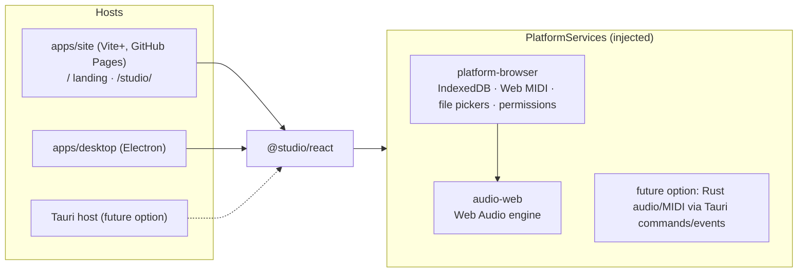
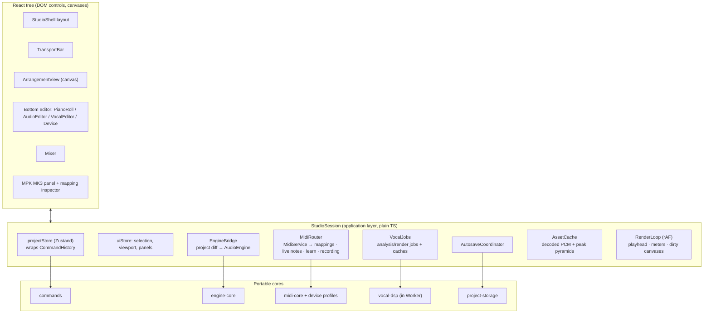
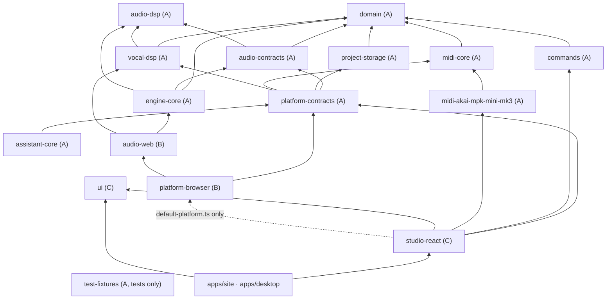
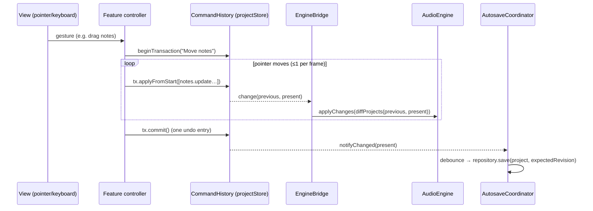
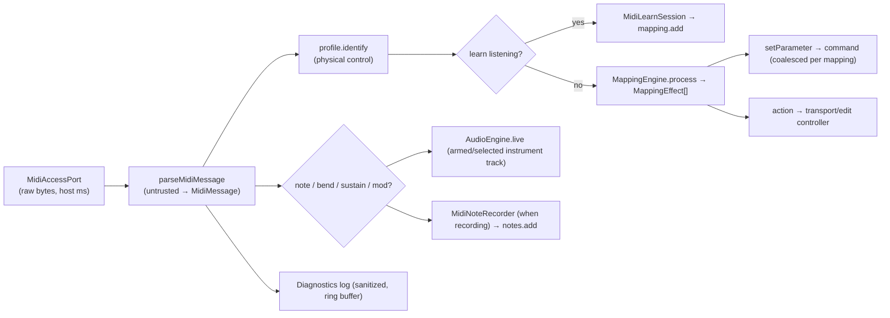
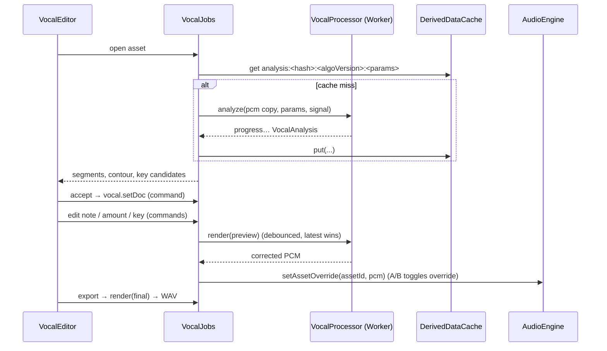
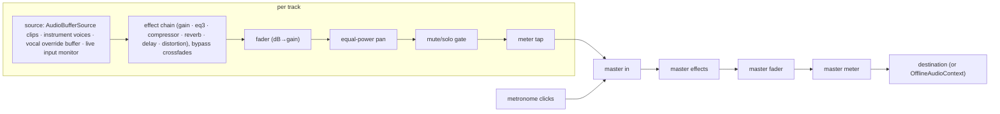

# Nawa — Architecture

Status: living document. Owner: tech lead. Last updated: 2026-11-02.
Related: [domain-model.md](domain-model.md) · [audio-engine.md](audio-engine.md) ·
[vocal-dsp.md](vocal-dsp.md) · [midi-device-research.md](midi-device-research.md) ·
[midi-integration.md](midi-integration.md) · [persistence.md](persistence.md) ·
[test-plan.md](test-plan.md) · [implementation-plan.md](implementation-plan.md) ·
[rust-migration-map.md](rust-migration-map.md) · [agent-workstreams.md](agent-workstreams.md) · [adr/](adr/)

## 1. Executive summary

Nawa is a local-first DAW delivered as **one portable React component, `<Studio />`**,
mounted by two thin hosts: a static Vite+ website (`apps/site`: landing page at `/`, the Studio
at `/studio/`, deployed to GitHub Pages at <https://itsdula.github.io/nawa/>) and an Electron
desktop app (`apps/desktop`, released through GitHub Releases). Audio runs on Web Audio in the
page on both; Electron only hosts Chromium. A native Rust backend under Tauri is a documented
future option ([hosts.md §2](hosts.md)), not planned work.

The codebase is split by **what can be ported to Rust and what cannot**:

- **Class A — portable cores** (pure TypeScript, deterministic, no DOM/Node/React):
  domain model and musical time, edit commands + undo, engine scheduling math, DSP
  primitives, vocal analysis/correction, MIDI parsing/mapping, persistence schemas,
  host contracts. Their `src` is compiled **without DOM or Node typings**, so host API use
  is a type error, not a code-review finding.
- **Class B — host adapters**: Web Audio engine (`audio-web`) and browser platform
  services (`platform-browser`: IndexedDB, Web MIDI, file pickers, permissions).
- **Class C — UI**: design-system primitives (`ui`) and the Studio application
  (`studio-react`).

Key decisions (each has an ADR):

| Decision         | Choice                                                                                                                                                                                                                                               | Why                                                                                                         |
| ---------------- | ---------------------------------------------------------------------------------------------------------------------------------------------------------------------------------------------------------------------------------------------------- | ----------------------------------------------------------------------------------------------------------- |
| Musical time     | Integer ticks, **960 PPQ**; one global tempo for v1                                                                                                                                                                                                  | exact straight/triplet grids, deterministic scheduling, tempo map later                                     |
| Persistent state | Immutable, normalized project model; every change is a serializable **command**; **snapshot undo history** with structural sharing                                                                                                                   | exact undo, cheap diffing for the engine and autosave, deterministic replay                                 |
| UI state         | Zustand stores for editor state; transport position, meters and playhead rendered from rAF **outside React**                                                                                                                                         | no React work at audio/frame rate                                                                           |
| Audio            | Web Audio graph built from native nodes; **AudioWorklet** only where audio-thread code is required (recording capture); scheduling via a lookahead scheduler on the `AudioContext` clock; **OfflineAudioContext** bounce through the same graph code | proven, sample-accurate, and offline/real-time parity                                                       |
| Engine API       | Backend-neutral `AudioEngine` port + pure `diffProjects()` change stream                                                                                                                                                                             | a Rust engine can implement the semantics without mimicking Web Audio                                       |
| Vocal DSP        | pYIN-style tracker + note HMM/rules + key profiles for analysis; **TD-PSOLA** for correction (formant-preserving by construction); Signalsmith Stretch as an alternative strategy behind `VocalProcessor`                                            | quality for monophonic voice, permissive licensing, small portable code                                     |
| MIDI             | Device-independent `midi-core` + separate device-profile packages; software mapping always works; **no SysEx writes** without a documented protocol                                                                                                  | honest hardware support                                                                                     |
| Persistence      | IndexedDB (Dexie) with project JSON separate from binary assets; versioned schema + migrations; zip bundle for portability                                                                                                                           | local-first, recoverable, portable                                                                          |
| Workers/worklets | esbuild-generated **inline bundles loaded from Blob URLs**                                                                                                                                                                                           | identical behaviour in any bundler (verified with Vite, Next/Turbopack and Electron) with no bundler config |
| Styling          | Tailwind v4 compiled into a **prebuilt, scoped `studio.css`** (no global preflight)                                                                                                                                                                  | hosts just import one stylesheet; Studio can be embedded                                                    |

## 2. Quality attributes and constraints

1. **Audio reliability first.** Scheduling is driven by the audio clock, never React or
   `requestAnimationFrame`. Rendering hiccups must not cause audible glitches.
2. **Non-destructive editing.** Source audio is immutable; trims, splits, fades, gain,
   loops and vocal corrections are parameters over immutable assets.
3. **Precise musical timing.** Integer ticks; conversions are pure functions with tests.
4. **Portability.** `<Studio />` has no `next/*` imports and no URL/public-path assumptions;
   host capabilities are injected through `PlatformServices`.
5. **Honesty.** Unverified hardware/DSP behaviour is labelled in UI and docs; incomplete
   features sit behind flags (`StudioFeatureFlags`); hardware program editing is
   hard-wired off until a documented protocol is verified.
6. **Local-first.** No account, backend or network dependency for core features.
7. **Accessibility.** Keyboard operation for every DOM control; canvases have DOM/ARIA
   alternatives for their essential functions (track list, note list inspector).

## 3. System context and runtime components



Runtime composition inside `<Studio />` (created by `createStudioSession(platform, config)`):



## 4. Packages, classification and dependency direction



| Package                  | Class | Responsibility                                                                                                                                  | May depend on                                                                                           |
| ------------------------ | ----- | ----------------------------------------------------------------------------------------------------------------------------------------------- | ------------------------------------------------------------------------------------------------------- |
| `domain`                 | A     | project model, IDs, ticks/seconds/frames, grid & quantize, theory, ParamSpecs, selectors (clip expansion), interval index, invariants, `Result` | —                                                                                                       |
| `commands`               | A     | `Command` union, pure `applyCommand`, snapshot `CommandHistory` (transactions, coalescing)                                                      | domain                                                                                                  |
| `engine-core`            | A     | `diffProjects`, transport clock, loop-aware window planning, timeline index, mute/solo + pan math, tail estimation, metronome events            | domain, audio-contracts, audio-dsp                                                                      |
| `audio-contracts`        | A     | `AudioEngine`/`AudioBackendFactory` ports, events, render/recording DTOs, `AudioGraphChange`                                                    | domain, audio-dsp                                                                                       |
| `audio-dsp`              | A     | `PcmAudio` layout, WAV codec, peak pyramids, drum synthesis, reverb IR, dither, seeded RNG                                                      | —                                                                                                       |
| `vocal-dsp`              | A     | pitch tracking, segmentation, key estimation, target curves, TD-PSOLA, `VocalProcessor` port + inline/worker processors                         | domain, audio-dsp                                                                                       |
| `midi-core`              | A     | parse/encode, stream parser, `MappingEngine`, learn, recorder, `MidiService`, `MidiAccessPort`, `MidiDeviceProfile`                             | domain                                                                                                  |
| `midi-akai-mpk-mini-mk3` | A     | MK3 profile: port matching, controls + verification, default mappings, layout geometry, capability matrix                                       | domain, midi-core                                                                                       |
| `project-storage`        | A     | zod schema, migrations, bundle format, repository ports + memory impls, autosave                                                                | domain                                                                                                  |
| `platform-contracts`     | A     | `PlatformServices` and host capability ports                                                                                                    | the A contracts above                                                                                   |
| `assistant-core`         | A     | AI assistant provider core: OpenAI-compatible chat client (injected `fetch`), OpenRouter/local presets, request guards (see docs/assistant.md)  | platform-contracts (types)                                                                              |
| `test-fixtures`          | A     | deterministic synthetic audio/MIDI fixtures                                                                                                     | domain, audio-dsp                                                                                       |
| `audio-web`              | B     | Web Audio `AudioEngine`, instruments, effects, recorder worklet, offline render, decoding                                                       | A packages                                                                                              |
| `platform-browser`       | B     | `createBrowserPlatform()`: IndexedDB, Web MIDI, pickers, permissions, worker hosts                                                              | A packages, audio-web                                                                                   |
| `ui`                     | C     | tokens + accessible primitives (buttons, menus, dialogs, fields…)                                                                               | react, radix-ui, lucide                                                                                 |
| `audio-ui`               | C     | audio controls and meters: Studio set (VolumeFader, ParameterKnob, StereoMeter…) on `@audio-ui/react` headless primitives; see its README       | react, @audio-ui/react, @base-ui/react, cn                                                              |
| `studio-react`           | C     | `<Studio />`, session, stores, features, canvas renderers                                                                                       | A packages, ui, audio-ui, platform-contracts (platform-browser only via `platform/default-platform.ts`) |

**Enforcement** (CI `pnpm boundaries`, `pnpm lint`, `pnpm typecheck`):

- dependency-cruiser: allowed-dependency lists per package, no cycles, no Node built-ins or
  UI/state libraries in class A, apps import only
  `@studio/react`/`@studio/ui`, `studio-react` features never import `platform-browser`.
- ESLint `no-restricted-imports` mirrors the class rules at edit time.
- Class A `tsconfig.src.json` has `lib: ES2023` and `types: []` (no DOM, no Node).

## 5. Directory tree

```
apps/
  site/                        static website (Vite+), deployed to GitHub Pages
    index.html                 landing page entry → src/landing-main.tsx, src/landing/
    studio/index.html          Studio entry → src/studio/main.tsx mounting <Studio/>
    vite.config.ts             two entries, base '/nawa/' (NAWA_BASE_PATH overrides)
  desktop/                     Electron app: src/main (protocol, CSP, IPC), src/preload,
                               src/renderer mounting <Studio/>, electron-builder.yml
  dev-monitor/                 `pnpm dev` orchestrator and log viewer
packages/
  domain/src/                  ids, time, grid, theory, params, model, factories, selectors,
                               intervals, invariants, result
  commands/src/                types (Command union), history-types, apply/* handlers, history
  engine-core/src/             diff, clock, window planning, timeline index, mix math, tails
  audio-contracts/src/         engine.ts (AudioEngine port), changes.ts (AudioGraphChange)
  audio-dsp/src/               pcm, wav, peaks, drums, reverb-ir, dither, random, gain
  audio-web/src/               engine, scheduler (+ worker timer), graph builder, instruments/,
                               effects/, recorder (worklet), metering, offline render, decode
  audio-web/scripts/codegen.mjs  inline Worker/AudioWorklet bundles → src/generated/
  vocal-dsp/src/               types (port), pitch/, segmentation/, key/, correction/,
                               psola/, processors (inline, worker protocol)
  midi-core/src/               messages, port, device-profile, types, parser, mapping,
                               learn, recorder, active-notes, service, clock
  midi-akai-mpk-mini-mk3/src/  profile, controls, layout, capabilities
  project-storage/src/         repositories (ports), schema, migrations, bundle, memory,
                               autosave
  platform-contracts/src/      platform.ts (PlatformServices et al.), assistant.ts
  assistant-core/src/          client (OpenAI-compatible), mapping, guards, errors, presets
  platform-browser/src/        create-browser-platform, storage/ (Dexie), midi/ (Web MIDI),
                               files, permissions, device-info, logger, hashing, workers/
  ui/src/                      tokens.ts/.css, components/, hooks/
  studio-react/src/            Studio.tsx, config.ts, session/, state/, canvas/,
                               components/, features/{transport,browser,arrangement,
                               piano-roll,audio-editor,vocal-editor,mixer,effects,
                               instrument,midi-controller,project,export}/, platform/,
                               styles/studio.css
  theme-core/src/              theme tokens, colour maths, CSS and canvas emission, presets
  audio-ui/src/                audio controls and meters on @audio-ui/react
  test-fixtures/src/           seeded generators, synthetic vowels, melodies
docs/                          this document, subsystem docs, ADRs, research
e2e/                           Playwright specs (landing, portability, studio/*)
scripts/                       inline-bundles.mjs, vitest-react-setup.ts
```

## 6. Data flows

### 6.1 Editing → audio → persistence



### 6.2 MIDI input



### 6.3 Vocal analysis and correction



### 6.4 Audio signal flow



### 6.5 Recording and export workflows

```mermaid
sequenceDiagram
  participant U as User
  participant S as Session
  participant E as AudioEngine
  participant R as Repositories
  U->>S: arm track, press Record
  S->>E: startRecording({trackIds, channelCount})
  E-->>S: recording status (permission → recording)
  E->>E: play transport; recorder worklet captures frames with context timestamps
  U->>S: Stop
  S->>E: stopRecording()
  E-->>S: RecordedTake[] (pcm, startTick after latency compensation)
  S->>R: encodeWav(pcm, 32-bit float) → assets.put; hash
  S->>S: commands: asset.register + clip.add (one undo entry)
```

Export: `engine.render({startTick,endTick,sampleRate,channelCount:2,tailSeconds:'auto'})`
→ `encodeWav(pcm, {bitDepth: 16, dither: 'tpdf'})` → `fileDialogs.saveFile`.

## 7. Core contracts (source of truth is the code)

| Contract                                                  | File                                                   |
| --------------------------------------------------------- | ------------------------------------------------------ |
| Project model, IDs, time, theory, params                  | `packages/domain/src/*.ts`                             |
| Commands + undo history                                   | `packages/commands/src/types.ts`, `history-types.ts`   |
| Audio engine port, changes                                | `packages/audio-contracts/src/engine.ts`, `changes.ts` |
| PCM layout                                                | `packages/audio-dsp/src/pcm.ts`                        |
| Vocal processor port + analysis DTOs                      | `packages/vocal-dsp/src/types.ts`                      |
| MIDI messages, host port, device profile, mapping effects | `packages/midi-core/src/*.ts`                          |
| Repositories                                              | `packages/project-storage/src/repositories.ts`         |
| Host services                                             | `packages/platform-contracts/src/platform.ts`          |

Representative pseudocode (abridged from the real contracts):

```ts
// Transport (engine-core): ticks ↔ engine time, loop-aware
tickAt(t)  = anchor.tick + (t - anchor.time) * bpm * PPQ / 60      // then wrap into loop
timeAt(k)  = anchor.time + (k - anchor.tick) * 60 / (bpm * PPQ)
every 25 ms (worker timer):
  horizon = ctx.currentTime + 0.12
  for segment in planWindow(scheduledUntilTick, tickAt(horizon), loop):   // splits at loop end
    for event in timelineIndex.query(segment.startTick, segment.endTick): // O(log n + k)
      schedule(event, timeAt(event.tick) in segment)                      // note-off clamped at loop end
  scheduledUntilTick = tickAt(horizon)

// Commands: pure, deterministic, undoable
applyCommand(project, { type: 'notes.update', clipId, patches }) → Project'  // structural sharing
history.beginTransaction('Move notes').applyFromStart([...]) … .commit()      // one undo entry

// MIDI mapping (midi-core)
for mapping in mappings where matches(mapping.source, event, mapping.device):
  normalized = transform(event, mapping.transform, reader.getNormalized(address))  // curve, range, pickup, relative
  emit { kind: 'setParameter', address, normalized } | { kind: 'action', action, value }

// Vocal (vocal-dsp)
analysis = analyzeVocal(pcm)            // pYIN track → non-pitched regions → segments → key candidates
target   = computeTargetPitchCurve(analysis.pitchTrack, doc.segments, doc)   // per-frame MIDI
ratio    = computePitchRatioCurve(track, target)                             // [0.5, 2]
output   = renderPitchCorrection(pcm, analysis, doc, 'preview' | 'final')    // TD-PSOLA, same length

// Platform adapters (platform-contracts)
interface PlatformServices { audioBackendFactory; createVocalProcessor; midiAccess;
  projectRepository; assetRepository; derivedCache; settingsRepository; preferences; fileDialogs;
  permissions; deviceInfo; logger; audioDecoder; hasher; randomId; now; dispose() }
```

## 8. Application state and rendering

- **projectStore** wraps `CommandHistory`; React selects slices with Zustand selectors;
  identity-stable entities mean memoized selectors rarely recompute.
- **uiStore** holds ephemeral state: selection sets, viewports (zoom/scroll per editor),
  panel sizes, active tool/editor, learn mode. Never persisted in the project.
- **Frame-rate data never enters React state**: the `RenderLoop` (one rAF loop) reads
  `engine.getTransportPosition()` and `engine.readMeters()` and draws the playhead, time
  readout (direct `textContent` writes) and meters (`@audio-ui/react` `Meter`s subscribed to a
  per-meter `FrameSource` that `useEngineMeterSource` feeds; they write the DOM directly, not React).
- **Canvas renderers** (arrangement, piano roll, waveform, pitch editor) are plain TS
  classes with `draw(ctx, viewModel)`; a shared `TimeAxis` (ticks ↔ px) guarantees the
  arrangement and piano roll use identical musical coordinates. Layers: static content
  canvas (redrawn on change) + overlay canvas (playhead, selection marquee, drag ghosts).
- **Gestures** are explicit state machines (idle → pressed → dragging → commit/cancel on
  Escape or lost pointer capture) feeding history transactions.

## 9. Data-structure and algorithm choices

| Problem                   | Choice                                                                                                     | Size assumptions             | Cost                                      | Alternatives / why not                                                                                      |
| ------------------------- | ---------------------------------------------------------------------------------------------------------- | ---------------------------- | ----------------------------------------- | ----------------------------------------------------------------------------------------------------------- |
| Musical time              | integer ticks @ 960 PPQ                                                                                    | ≤ 10⁹ ticks (hours)          | exact integer math                        | float beats (drift, inexact triplets); 480 PPQ (no 1/64T)                                                   |
| Entity storage            | normalized ID maps + order arrays, immutable                                                               | ≤ 200 tracks, ≤ 10⁴ clips    | O(1) lookup, O(changed) copy              | arrays (O(n) lookup), mutable store (no cheap diff/undo)                                                    |
| Notes in a clip           | sorted array by (start, pitch, id)                                                                         | ≤ 10⁴ per clip               | O(n) update copy, O(log n) window search  | ID map (needs sorting for every schedule/draw)                                                              |
| Clip visibility / overlap | start-sorted array + max-length bound (`SortedIntervalIndex`)                                              | ≤ 500 clips per track        | build O(n log n), query O(log n + k)      | interval tree (more code, benefit only for long overlapping intervals) — revisit only on profiling evidence |
| Event scheduling          | per-track sorted event arrays + binary search per window                                                   | ≤ 10⁵ events                 | O(log n + k) per 25 ms tick               | priority queue (unneeded: events are static between edits; index rebuilt per changed clip)                  |
| Undo                      | snapshot pairs with structural sharing, count-bounded                                                      | 200 entries                  | O(1) undo/redo; memory ∝ changed entities | inverse commands (drift risk), Immer patches (extra dependency, same semantics)                             |
| Engine updates            | reference-identity `diffProjects`                                                                          | ≤ 10⁴ entities               | O(tracks + clips) per change              | full reload (expensive), fine-grained observables (complex)                                                 |
| Waveforms                 | multiresolution min/max peak pyramid (×4 per level)                                                        | hours of audio               | build O(n), query O(columns)              | raw sample scan at draw time (O(n) per frame)                                                               |
| Audio across threads      | planar Float32Array, transferred (not copied)                                                              | MBs per job                  | O(1) transfer                             | SharedArrayBuffer ring buffers (require COOP/COEP; optional later)                                          |
| Recording capture         | worklet → chunked Float32 messages with frame stamps → concatenate at stop                                 | ≤ 1 h mono                   | O(n)                                      | MediaRecorder (compressed, no sample-accurate timestamps)                                                   |
| Pitch tracking            | pYIN (YIN CMNDF + threshold distribution + HMM Viterbi)                                                    | 5 ms hop, ≤ 10 min           | O(frames × states × band)                 | MPM/ACF (less robust voicing), CREPE (model size, licence of weights, speed)                                |
| Note segmentation         | HMM/rules on the pitch track (+ DP change-point alternative)                                               | ≤ 10⁵ frames                 | O(frames × states)                        | heuristic threshold splitting only (fragile with vibrato)                                                   |
| Key estimation            | duration-weighted pitch-class profile correlation (Albrecht–Shanahan / Aarden–Essen) + softmax confidences | 24 keys                      | O(24 × 12)                                | HMM key tracking (needs longer material; deferred)                                                          |
| Pitch correction          | TD-PSOLA with pitch marks from the analysis                                                                | ≤ ±12 st (quality best ≤ ±4) | O(n)                                      | phase vocoder (formant smearing), Rubber Band (GPL), resampling (formant shift, duration change)            |
| MIDI mappings             | linear scan over enabled mappings per event                                                                | ≤ 500 mappings               | O(m) per event                            | per-source hash index (add if profiling shows need)                                                         |
| Recorded note pairing     | map (channel, pitch) → open-note stack + sustain set                                                       | 16 × 128                     | O(1) per event                            | —                                                                                                           |

## 10. Design-pattern selection (GoF), used deliberately

| Pattern                              | Where                                                                                                                    | Why it fits                                                              | Not used / why                     |
| ------------------------------------ | ------------------------------------------------------------------------------------------------------------------------ | ------------------------------------------------------------------------ | ---------------------------------- |
| Command                              | `commands`                                                                                                               | serializable edits, undo/redo, transactions, replay, MIDI-driven changes | —                                  |
| Memento (implicit)                   | snapshot history                                                                                                         | immutable project roots are mementos; exact undo                         | —                                  |
| Strategy                             | `VocalProcessor` (TD-PSOLA vs alternative), snapping/quantize options, mapping curves, `AudioBackendFactory` per host    | swap algorithms without changing callers                                 | —                                  |
| Adapter                              | `audio-web` (Web Audio → `AudioEngine`), `platform-browser` (IndexedDB/Web MIDI → ports), worker-backed `VocalProcessor` | host APIs behind stable ports                                            | —                                  |
| Abstract Factory / Factory Method    | `AudioBackendFactory`; instrument/effect factories inside the engine create compatible node groups                       | hides concrete node graphs                                               | —                                  |
| Facade                               | `AudioEngine` (one high-level surface over graph, scheduler, recorder, renderer); `StudioSession`                        | narrow API for the UI                                                    | —                                  |
| Observer                             | typed subscriptions: engine events, history changes, MIDI events, device lists                                           | targeted, typed, unsubscribe-able                                        | no global event bus ("event soup") |
| State                                | gesture state machines, MIDI learn session, recording status, autosave status                                            | explicit transitions where bugs hide                                     | not for trivial toggles            |
| Composite                            | effect chains as ordered unit lists with a uniform `EffectUnit` interface                                                | uniform bypass/dispose/connect                                           | no nested groups in v1             |
| Mediator/Singleton/Visitor/Decorator | —                                                                                                                        | not needed; singletons replaced by injected session objects              | —                                  |

## 11. Host capability matrix (summary)

Full matrix with sources: [research/platform-compatibility.md §2](research/platform-compatibility.md).

| Capability                               | Chrome/Edge                                          | Firefox                                             | Safari      | Electron 45                            | Tauri, future (Win / macOS / Linux)  |
| ---------------------------------------- | ---------------------------------------------------- | --------------------------------------------------- | ----------- | -------------------------------------- | ------------------------------------ |
| Web MIDI                                 | ✅ (permission prompt for all MIDI since Chrome 124) | ⚠️ site-permission add-on; no hotplug events (poll) | ❌          | ✅ (grant `midi` via session handlers) | ✅ / ❌ / ❌ → native `midir` bridge |
| AudioWorklet / OfflineAudioContext       | ✅                                                   | ✅                                                  | ✅          | ✅                                     | ✅ / ✅ / ⚠️                         |
| Mic capture constraints (AEC/NS/AGC off) | ✅                                                   | ✅                                                  | ⚠️ AEC only | ✅                                     | ✅ / ⚠️ / ⚠️                         |
| `outputLatency`                          | ✅                                                   | ✅                                                  | ✅ 18.4+    | ✅                                     | ✅ / ⚠️ / ❓                         |
| File System Access pickers               | ✅                                                   | ❌ (fallback input/download)                        | ❌          | native dialogs via preload             | Tauri dialog plugin                  |
| SharedArrayBuffer                        | needs COOP/COEP (not on GitHub Pages)                | same                                                | same        | protocol headers                       | ❓                                   |

Plugin hosting (VST/AU/CLAP) is impossible in browsers and out of scope; a native backend
could add it later. Audio latency in browsers is typically 10–40 ms output plus device
input latency; Nawa reports `baseLatency`/`outputLatency` and lets users calibrate.

## 12. Risks, spikes and benchmarks

| Risk                                                                             | Impact            | Mitigation / spike                                                                             | Gate                                                   |
| -------------------------------------------------------------------------------- | ----------------- | ---------------------------------------------------------------------------------------------- | ------------------------------------------------------ |
| Scheduler starvation in background tabs                                          | missed notes      | worker-driven timer; lookahead 100–150 ms                                                      | browser test: notes on time with main-thread busy-loop |
| Offline vs real-time parity drift                                                | export ≠ playback | single graph-construction path; render tests                                                   | browser render tests                                   |
| Vocal correction quality (breathy voice, fry, large shifts)                      | artefacts         | TD-PSOLA + pitch-mark refinement; ratio clamp; honest limits; alternative strategy slot        | objective metrics + listening checklist                |
| pYIN cost in JS                                                                  | slow analysis     | banded Viterbi, chunking at unvoiced gaps, workers, caching                                    | ≤ 0.15× real time (Node)                               |
| MPK Mini MK3 facts partly unverified (official docs unreachable in this sandbox) | wrong defaults    | verification labels everywhere, learn-first workflow, HIL checklist                            | physical test before claiming support                  |
| Web MIDI unavailable (Safari/Firefox quirks)                                     | no controller     | capability detection, clear UI state, on-screen keyboard                                       | unit tests with fake ports                             |
| IndexedDB quota/eviction, Safari blob bugs                                       | data loss         | Uint8Array storage, `storage.persist()` request, bundle export, backup revision                | IndexedDB contract tests                               |
| React re-render storms                                                           | jank              | frame data outside React, selectors, canvas layers                                             | profiling budget (Phase 8)                             |
| Worker/worklet loading differences across hosts                                  | broken features   | inline Blob-URL bundles; CSP documented (`script-src 'self' blob:`, `worker-src 'self' blob:`) | portability E2E on the site; Electron smoke test       |

Benchmarks (method in [test-plan.md](test-plan.md) §6): 16-track/100-clip offline render
time, scheduler tick cost, meter read cost, arrangement draw time at extreme zoom, MIDI
input → note-on latency (software path), pitch-analysis and render throughput, memory
growth over a 30-minute session. Targets are set after baselines are recorded.

**Deferred decisions:** tempo maps; time-stretching/warping (and vocal timing edits);
plugin formats; collaborative editing; OPFS asset storage; SharedArrayBuffer transport;
neural pitch tracking option; hardware program editing (blocked on a documented protocol).

## 13. Security and privacy

- All content stays on the device; no telemetry.
- Imported bundles/files are untrusted: size limits, path validation, checksum checks,
  zod validation and invariant checks before anything enters the store.
- MIDI input is untrusted bytes: parsed with validation; SysEx never sent; diagnostics
  sanitize/truncate payloads.
- Electron: `contextIsolation`, `sandbox`, no `nodeIntegration`, typed preload bridge,
  explicit permission handlers for `media`/`midi` (never `midiSysex` by default).
- CSP for hosts: `script-src 'self' blob:`; `worker-src 'self' blob:` (inline bundles).
