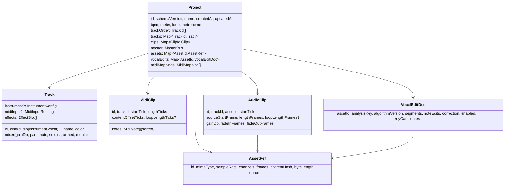

# Domain model

Source of truth: `packages/domain/src/model.ts` (types), `factories.ts` (defaults),
`invariants.ts` (structural rules), `params.ts` (parameter ranges), `time.ts`/`grid.ts`
(musical time). This document explains the model; it never overrides the code.

## Principles

1. **Serializable plain data.** No classes, typed arrays or audio buffers in the project.
2. **Normalized.** `tracks`, `clips`, `assets` and `vocalEdits` are ID-keyed maps;
   ordering lives in `trackOrder` and in sorted arrays (`MidiClip.notes`, vocal segments).
3. **Immutable values.** Commands return new objects; untouched entities keep identity
   (structural sharing), which makes undo, engine diffing and autosave cheap.
4. **Deterministic commands.** IDs are created by callers and carried in commands;
   the domain never reads clocks or randomness.
5. **Persistent vs ephemeral.** Selection, zoom, scroll, panel sizes, transport position
   and meter values are UI/runtime state and never stored in the project.

## Time and units

| Unit    | Type alias | Meaning                                                              |
| ------- | ---------- | -------------------------------------------------------------------- |
| ticks   | `Ticks`    | integer musical time; `PPQ = 960` per quarter note                   |
| seconds | `Seconds`  | float audio/wall time                                                |
| frames  | `Frames`   | integer sample frames at a stated sample rate (asset rate for clips) |
| BPM     | `number`   | quarter notes per minute (independent of meter denominator)          |

`ticksToSeconds(t, bpm) = t·60/(bpm·PPQ)`. Grid steps (`gridDivisionTicks`) are integers
for straight and triplet divisions down to 1/64 (straight) and 1/32T. Transport display
uses bars.beats.sixteenths (`formatBarsBeats`), 1-based.

## Entities

### Tracks

- `instrument` tracks host MIDI clips and an `InstrumentConfig` (`synth`, `drums`,
  `sampler`) whose numeric `params` follow `INSTRUMENT_PARAM_SPECS`.
- `audio` and `vocal` tracks host audio clips. A vocal track is an audio track whose
  default editor is the vocal editor.
- Effects are ordered `EffectSlot`s (`gain`, `eq3`, `compressor`, `reverb`, `delay`,
  `distortion`) with params from `EFFECT_PARAM_SPECS`; the master bus has its own chain.
- Mute/solo: a track is audible iff `!mute && (!anySolo || solo)` (`isTrackAudible`).

### Clips (non-destructive)

- **MIDI clip**: timeline window `[startTick, startTick + lengthTicks)` shows content from
  `contentOffsetTicks`; with `loopLengthTicks`, content `[0, loop)` repeats. Notes are in
  content time. `expandMidiClipNotes` produces absolute timeline notes (notes starting
  before the window are dropped, notes are cut at the clip end and at loop boundaries).
- **Audio clip**: plays source frames from `sourceStartFrame` for `lengthFrames` (optionally
  looping the first `loopLengthFrames`). Timeline length in ticks is **derived** from the
  asset sample rate and project tempo — audio is not time-stretched when tempo changes.
- Splitting a clip creates a second clip with adjusted offsets; MIDI halves share the same
  notes array (structural sharing). Trims change offsets/lengths only.
- Note IDs are unique **within** a clip.

### Assets

`AssetRef` is metadata; the encoded bytes live in the `AssetRepository`. `contentHash`
(SHA-256 of the stored bytes) keys derived data: peak pyramids, pitch analyses and vocal
renders (`<kind>:<contentHash>:<algorithmVersion>:<paramsHash>`).

### Vocal edits

Vocal corrections apply to an **asset in source time** (`vocalEdits[assetId]`), so every
clip that plays that asset (including split/duplicated clips) hears the same correction.
The heavy analysis (pitch track, typed arrays) is derived data in the cache; the doc stores
only what the user owns: accepted note segments (after split/merge), per-note edits,
global correction settings, A/B `enabled` flag, and key suggestions for display.

### MIDI mappings

`MidiMapping` = source (CC absolute/relative, note trigger/gate/toggle, pitch bend,
program change) + optional device selector (profile id or port name) + target
(`ParameterAddress` or `StudioActionId`) + transform (range, invert, curve, takeover,
relative step) + scope. Project-scoped mappings live in the project; global mappings live
in host settings. Parameter values are exchanged in normalized space (0..1) and mapped
with each parameter's `ParamSpec` curve (`linear`, `log`, `db`).

## Invariants (checked by `checkProjectInvariants`)

- `trackOrder` lists every track exactly once; map keys equal entity ids.
- Clips reference existing tracks; MIDI clips only on instrument tracks, audio clips only
  on audio/vocal tracks; audio clips reference existing assets.
- Tick positions/lengths are integers; lengths > 0; offsets ≥ 0.
- Notes: unique ids, integer start ≥ 0, duration ≥ 1, pitch 0..127, velocity 1..127, sorted.
- Audio: fades non-negative and fit the clip; non-looping clips stay within the asset.
- Loop end > loop start ≥ 0; BPM within [20, 400]; valid time signature.
- Vocal docs reference existing assets; segments sorted. Mapping ids unique.

## Commands

See `packages/commands/src/types.ts` for the full union. Groups: project (rename, tempo,
meter, loop, metronome), tracks (add/remove/update/move/mixer/instrument), effects
(add/remove/move/params/bypass on tracks or master), clips (add/remove/move/update/trim
start/trim end/split), notes (add/remove/update/quantize), assets (register/remove),
vocal (doc, correction, note edits, clear targets, reset, replace segments, A/B),
mappings (add/update/remove).

Error policy: missing entities, kind mismatches and broken preconditions throw
`CommandError`; numeric values outside their `ParamSpec` are clamped. A command that
changes nothing returns the same project reference (no undo entry).

## Schema versioning

`CURRENT_SCHEMA_VERSION = 1`. Stored projects are migrated step-by-step and validated
(schema → invariants) on load; newer versions are rejected, never downgraded. Details in
[persistence.md](persistence.md).
