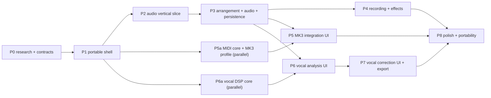

# Implementation plan

Phases are delivered as verified milestones. A phase is complete only when its acceptance
tests pass in CI and the "what works / what was measured / what remains" report is written
in [agent-workstreams.md](agent-workstreams.md). Incomplete capabilities stay behind
`StudioFeatureFlags`.

## Dependency graph

Portable cores (commands, engine, DSP, MIDI, storage, vocal) are built in parallel by
agents against frozen contracts; the lead serializes the shared UI shell and integration.

## Phase 0 — Research and design ✅

Deliverables: research dossiers (MK3, vocal DSP, platform), architecture, domain model,
ADRs, contracts in code, test plan, Rust migration map, workstream plan.
Acceptance: contracts typecheck; boundaries enforced by tooling.

## Phase 1 — Portable shell

Scope: workspace/tooling/CI; Next.js `/` and `/studio`; Vite host; `<Studio />` package
with injected platform; design system (`@studio/ui`); domain + commands implementation;
browser platform adapters (storage, MIDI port, pickers, permissions).
Acceptance:

- `/` renders and links to `/studio`; `/studio` mounts the same `<Studio />` as the Vite host
  (Playwright portability spec on both hosts).
- `pnpm check` green (format, lint, typecheck, boundaries, unit, build).
- Commands: invariant-preserving property tests; undo/redo exactness.

## Phase 2 — Audio vertical slice (must work before breadth)

Scope: instrument track → MIDI clip → piano roll (draw/move/resize/velocity/audition) →
poly synth → scheduled playback → loop → stop/seek → offline WAV export.
Acceptance (automated):

- Browser test: offline render of a drawn A4 note has a 440 Hz ±1% peak in the right window.
- E2E: create clip, draw notes, play, loop toggle, stop, seek, export → downloaded WAV
  decodes, non-silent, correct duration.
  Manual: listen for clicks/stuck notes during looped playback and edits while playing.

## Phase 3 — Arrangement and audio

Scope: audio import (WAV everywhere, MP3 where decodable), waveform peaks, track
add/remove/rename/reorder/recolor, clip move/trim/split/duplicate/loop/copy/paste/delete,
snapping, multi-select, zoom/scroll, mixer (gain/pan/mute/solo/meters/clip indicator),
persistence (autosave, reload, recovery), undo/redo across all edits, bundle import/export.
Acceptance: E2E import → edit → save → reload reproduces the arrangement (asserted on
persisted project JSON and rendered audio); IndexedDB recovery test.

## Phase 4 — Recording and effects

Scope: microphone recording (permission states, arm, monitoring toggle, latency
compensation + calibration setting, non-destructive takes), effect chains (add/remove/
reorder/bypass, all six effects audible), export fidelity (16-bit 44.1/48 kHz, tails).
Acceptance: E2E with Chromium's fake microphone records a non-silent take placed at the
expected position; effect browser tests prove every parameter changes the sound.

## Phase 5 — AKAI MPK Mini MK3 integration

Scope: MIDI device list/hotplug/permissions, note routing to armed/selected instrument
tracks, pads to drums, MIDI Learn, editable mappings (global/project, import/export,
reset, conflicts), soft takeover, velocity curves, transpose/channel filters, panic,
diagnostics view, skeuomorphic MK3 panel with live activity and mapping inspector,
hardware-vs-software settings separation. Hardware program editing stays unsupported.
Acceptance: unit/contract tests with fake ports; E2E with an injected virtual MIDI device
(learn → mapping persisted → reload restores); accessibility checks. **Physical-device
validation is a manual HIL protocol and remains "unverified" until run on real hardware.**

## Phase 6 — Vocal analysis

Scope: worker analysis with progress/cancel/caching, segments, non-pitched regions, key
candidates, pitch grid with keyboard, note blobs, contour, scale guides, uncertainty styling.
Acceptance: objective metrics on synthetic fixtures (vocal-dsp tests); E2E import of a
synthetic vocal → analysis completes → notes and key candidates displayed.

## Phase 7 — Vocal processing

Scope: TD-PSOLA correction with per-note targets, auto amount/retune/humanize, drift and
vibrato control, transitions, split/merge, A/B, preview renders via asset override,
final render/export, formant option only if verified.
Acceptance: moving a note by +2 st yields ≤ 10 cent median error after re-analysis;
E2E: move a target note, A/B toggles audible difference (rendered audio differs),
export produces corrected WAV.

## Phase 8 — Polish and portability

Scope: performance profiling and budgets, keyboard accessibility audit, migrations,
Electron host smoke test, Tauri backend design, landing page with authentic screenshots,
full CI.
Acceptance: full suite green; documented baselines; Electron smoke test mounts Studio.

## Reporting format per phase

1. What works (with test evidence) · 2. What was measured (numbers + method) ·
2. What remains / known limitations · 4. Next steps.
