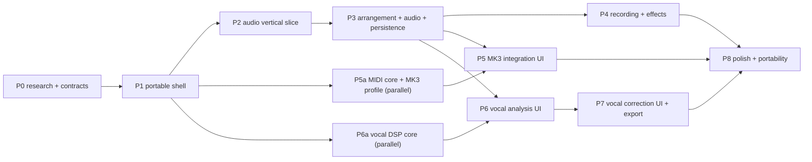

# Implementation plan

Phases are delivered as verified milestones. A phase is complete only when its acceptance
tests pass in CI and the "what works / what was measured / what remains" report is written
in [agent-workstreams.md](agent-workstreams.md). Incomplete capabilities stay behind
`StudioFeatureFlags`.

## Dependency graph

Portable cores (commands, engine, DSP, MIDI, storage, vocal) are built in parallel by
agents against frozen contracts; the lead serializes the shared UI shell and integration.

## Phase 0 — Research and design ✅

Deliverables: research dossiers (MK3, vocal DSP, platform), architecture, domain model,
ADRs, contracts in code, test plan, Rust migration map, workstream plan.
Acceptance: contracts typecheck; boundaries enforced by tooling.

## Phase 1 — Portable shell ✅

Scope: workspace/tooling/CI; Next.js `/` and `/studio`; Vite host; `<Studio />` package
with injected platform; design system (`@studio/ui`); domain + commands implementation;
browser platform adapters (storage, MIDI port, pickers, permissions).
Acceptance:

- `/` renders and links to `/studio`; `/studio` mounts the same `<Studio />` as the Vite host
  (Playwright portability spec on both hosts).
- `pnpm check` green (format, lint, typecheck, boundaries, unit, build).
- Commands: invariant-preserving property tests; undo/redo exactness.

**Status (2026-10-29).** Works: both hosts mount the same `<Studio />` (portability E2E on
`web` and `vite`); lint, typecheck (portable packages without DOM/Node types), boundaries
(448 modules, 0 violations) and build green; commands property tests (360 tests).

## Phase 2 — Audio vertical slice (must work before breadth) ✅

Scope: instrument track → MIDI clip → piano roll (draw/move/resize/velocity/audition) →
poly synth → scheduled playback → loop → stop/seek → offline WAV export.
Acceptance (automated):

- Browser test: offline render of a drawn A4 note has a 440 Hz ±1% peak in the right window.
- E2E: create clip, draw notes, play, loop toggle, stop, seek, export → downloaded WAV
  decodes, non-silent, correct duration.
  Manual: listen for clicks/stuck notes during looped playback and edits while playing.

**Status (2026-10-29).** Works: `e2e/studio/vertical-slice.spec.ts` (create clip, draw
notes, play, loop, stop, seek, export: decoded WAV is stereo, ≥ 1.9 s, peak > 0.01);
piano-roll undo/redo; Delete removes notes, not the edited clip. Engine browser tests
cover pitch/timing of rendered notes, loop wraps and edits while playing (82 tests).
Measured: scheduler pass mean 0.17–0.35 ms (max 7.1 ms, no late events) — see
[benchmarks](benchmarks.md). Remains: the manual listening pass on real speakers
(this environment has no audio output); count-in is not implemented in the engine.

## Phase 3 — Arrangement and audio ✅

Scope: audio import (WAV everywhere, MP3 where decodable), waveform peaks, track
add/remove/rename/reorder/recolor, clip move/trim/split/duplicate/loop/copy/paste/delete,
snapping, multi-select, zoom/scroll, mixer (gain/pan/mute/solo/meters/clip indicator),
persistence (autosave, reload, recovery), undo/redo across all edits, bundle import/export.
Acceptance: E2E import → edit → save → reload reproduces the arrangement (asserted on
persisted project JSON and rendered audio); IndexedDB recovery test.

**Status (2026-10-29).** Works: WAV import onto a new audio track with peaks; autosave →
reload restores the project including audio (E2E, asserted by bouncing the reloaded
project); `.studio` bundle export → new project → import restores name, tracks and audio
(E2E); clip move/trim/split/duplicate/copy/paste/delete/loop through the session
(integration tests); mixer mute/solo/pan/fader laws and meters (engine browser tests);
IndexedDB backup-revision recovery (storage contract suites). Measured: serialize 5.8 ms
and parse 5.6 ms for a 671 KiB project. Remains: MP3/AAC import depends on the browser's
decoder (WAV is decoded in-house everywhere).

## Phase 4 — Recording and effects ✅

Scope: microphone recording (permission states, arm, monitoring toggle, latency
compensation + calibration setting, non-destructive takes), effect chains (add/remove/
reorder/bypass, all six effects audible), export fidelity (16-bit 44.1/48 kHz, tails).
Acceptance: E2E with Chromium's fake microphone records a non-silent take placed at the
expected position; effect browser tests prove every parameter changes the sound.

**Status (2026-10-29).** Works: arming an audio track and recording Chromium's fake
microphone produces a take that is placed as a clip and is audible in the bounce (E2E);
a denied microphone stops the transport and explains the fix (E2E); every parameter of
all six effects measurably changes the output, and bypass is transparent (engine browser
tests); a Gain effect at −60 dB silences the bounce and bypass restores it (E2E). The
Settings dialog shows the reported latencies and accepts a manual compensation value.
Remains: automatic loopback latency calibration; real-device latency depends on hardware
and is not measured here; count-in.

## Phase 5 — AKAI MPK Mini MK3 integration ✅ (software; hardware unverified)

Scope: MIDI device list/hotplug/permissions, note routing to armed/selected instrument
tracks, pads to drums, MIDI Learn, editable mappings (global/project, import/export,
reset, conflicts), soft takeover, velocity curves, transpose/channel filters, panic,
diagnostics view, skeuomorphic MK3 panel with live activity and mapping inspector,
hardware-vs-software settings separation. Hardware program editing stays unsupported.
Acceptance: unit/contract tests with fake ports; E2E with an injected virtual MIDI device
(learn → mapping persisted → reload restores); accessibility checks. **Physical-device
validation is a manual HIL protocol and remains "unverified" until run on real hardware.**

**Status (2026-10-29).** Works with a simulated Web MIDI port named like the community
reports ("MPK mini 3"): profile detection with no SysEx request; pads/keys routed to the
selected instrument; knob 1 → track volume with pickup takeover; MIDI Learn to a project
mapping (undoable); project and global mappings survive a reload; hot-unplug/reconnect
(E2E, 6 tests; 314 unit/contract tests in midi-core and the profile). Remains: the
physical-device protocol in [midi-integration.md](midi-integration.md) — no claim of
hardware compatibility is made until it is run; hardware program editing stays
unsupported (no documented, verified protocol).

## Phase 6 — Vocal analysis ✅

Scope: worker analysis with progress/cancel/caching, segments, non-pitched regions, key
candidates, pitch grid with keyboard, note blobs, contour, scale guides, uncertainty styling.
Acceptance: objective metrics on synthetic fixtures (vocal-dsp tests); E2E import of a
synthetic vocal → analysis completes → notes and key candidates displayed.

**Status (2026-10-29).** Works: analysis runs in the browser's Web Worker (inline Blob
bundle) and the editor shows notes, names and ranked key candidates (E2E); objective
metrics on synthetic fixtures: raw pitch accuracy 98.8%, octave errors 0%, voicing recall
99.3%, false alarms 0% on noise/breath/sibilants/silence, key top-1 93.1% / top-3 100%
(29 melodies); analysis 0.040× real time (Node, 60 s at 48 kHz).

## Phase 7 — Vocal processing ✅

Scope: TD-PSOLA correction with per-note targets, auto amount/retune/humanize, drift and
vibrato control, transitions, split/merge, A/B, preview renders via asset override,
final render/export, formant option only if verified.
Acceptance: moving a note by +2 st yields ≤ 10 cent median error after re-analysis;
E2E: move a target note, A/B toggles audible difference (rendered audio differs),
export produces corrected WAV.

**Status (2026-10-29).** Works: Auto Tune at 100% on a synthetic vowel detuned by
−30/+20/−15 cents exports a WAV whose re-analysed notes sit at −0.1/0.0/−0.3 cents (E2E);
+2/−3 semitone moves land within 0.13–0.64 cents median; duration exact; unvoiced audio
bit-identical; formant peaks move 0.2–4.0% with TD-PSOLA vs 10.9–17.5% for naive
resampling; render 0.013× real time. Remains: monophonic only; legato repeated notes
merge (split manually); pitch-down beyond −7 st sounds buzzy; formant shift judged by
objective measures only (no listening test), so the UI limits it; arrangement bounces
use the preview-quality render, while "Export corrected WAV" uses the final render.

## Phase 8 — Polish and portability (in progress)

Scope: performance profiling and budgets, keyboard accessibility audit, migrations,
Electron host smoke test, Tauri backend design, landing page with authentic screenshots,
full CI.
Acceptance: full suite green; documented baselines; Electron smoke test mounts Studio.

**Status (2026-10-29).** Done: Electron host (custom `studio://` origin, CSP, sandbox,
validated IPC) with a full smoke test that boots Studio in Electron 45 (38 checks) and a CI
job; Tauri backend design in [hosts.md](hosts.md); landing page with authentic screenshots
captured from the running app; baselines in [benchmarks.md](benchmarks.md). Bugs found only
in a real browser and fixed: Tailwind cascade-layer order (utilities were overridden by
the scoped reset), hidden Radix tab panels taking space, the browser panel's import button
hidden by overflow, and global Delete deleting the edited clip. Remains: a formal
accessibility audit (axe + screen-reader pass), real-hardware MIDI and latency checks,
and Firefox/Safari runs (CI covers Chromium only).

## Reporting format per phase

1. What works (with test evidence) · 2. What was measured (numbers + method) ·
2. What remains / known limitations · 4. Next steps.
