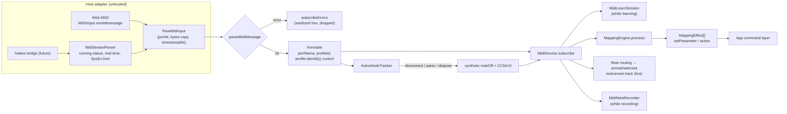

# MIDI integration

Status: implemented and unit-tested in Node. **Not yet tested with a physical controller.**
Nothing in this document claims hardware compatibility that has not been measured; see
[the hardware-in-the-loop protocol](#10-hardware-in-the-loop-test-protocol-mpk-mini-mk3) for how
that will be established.

| Package                                 | Role                                                                                          |
| --------------------------------------- | --------------------------------------------------------------------------------------------- |
| `@studio/midi-core`                     | Portable core: parsing, mapping, learn, recording, panic, clock maths, `MidiService`          |
| `@studio/midi-akai-mpk-mini-mk3`        | Researched device profile: controls, defaults, verification levels, layout, capability matrix |
| `@studio/platform-browser` (`src/midi`) | `createWebMidiAccessPort()`: Web MIDI implementation of `MidiAccessPort`                      |

`midi-core` has no DOM or Node typings; clocks (`now()`), tick conversion (`tickAt()`) and
parameter values (`ParameterValueReader`) are injected. The host adapter only moves bytes, so a
native bridge (e.g. Rust `midir` for Tauri on macOS/Linux) can implement the same port.

## 1. Pipeline



### Validation rules (`parseMidiMessage`)

- One complete message per call (what Web MIDI delivers). Running status is rejected here;
  `MidiStreamParser` handles raw streams.
- Channels are reported as 1..16. Note-on with velocity 0 becomes `noteOff`. Pitch bend is
  centred: −8192..8191.
- Errors (never thrown): `empty`, `unexpected-data-byte` (stray data, trailing bytes, stray
  `F7`), `truncated`, `data-out-of-range` (data byte > 127), `unterminated-sysex` (no `F7`, or
  interrupted by a status byte), `undefined-status` (`F4 F5 F9 FD`).
- `encodeMidiMessage` throws `RangeError` for out-of-range fields: those can only be app bugs.
- `MidiStreamParser` caps SysEx at 64 KiB by default; larger messages are reported and
  discarded until their `F7`.
- `describeMidiMessage` / `formatMidiBytes` produce sanitized, single-line text for the
  diagnostics view (SysEx truncated to 8 bytes, raw buffers truncated to 16 bytes).

## 2. `MidiService`

```ts
const midi = new MidiService({
  port: platform.midiAccess,
  profiles: [mpkMiniMk3Profile],
  now: () => performance.now(),
});
await midi.requestAccess({ sysex: false }); // the type only allows false
```

- **Devices.** `listDevices()` returns inputs then outputs, sorted by display name, each with
  the best-scoring profile (`matchPort` > 0). `subscribeDevices` fires only when the list
  actually changes.
- **Duplicate names.** Ports of the same type and name get `"Name"`, `"Name (2)"`, … New
  ports (sorted by id) take the lowest free ordinal; a known port keeps its ordinal for as long
  as the host lists it, so names do not reshuffle when a twin is unplugged. Events and
  mappings use the raw `portName` (stable across sessions); the suffix is display-only, so two
  identical devices cannot be told apart by a `portName` mapping.
- **Errors.** Invalid bytes are dropped and reported (`invalid-input` with a hex preview);
  exceptions from subscribers, profiles or the port are caught and reported
  (`listener-failed`, `send-failed`, `access-failed`). Nothing is thrown into host callbacks.
- **Send.** `send(portId, message, timestampMs?)` returns a `Result`; it refuses SysEx
  (`sysex-not-allowed`), unknown/disconnected ports, inputs and invalid messages.
- **Dispose** releases sounding notes, detaches from the port and clears listeners. The port
  belongs to `PlatformServices` and is not closed.

## 3. Mapping semantics (`MappingEngine`)

`setMappings(mappings)` then, per event, `process(event, reader)` → `MappingEffect[]`. Apply
effects synchronously before the next event: pickup relies on the reader seeing them.

| Aspect          | Behaviour                                                                                                                                                                                                                                                                                                                               |
| --------------- | --------------------------------------------------------------------------------------------------------------------------------------------------------------------------------------------------------------------------------------------------------------------------------------------------------------------------------------- |
| Device selector | `null` or `{}` = any device; else matches when `profileId` equals the event's profile **or** `portName` equals the raw port name                                                                                                                                                                                                        |
| Channel         | `'any'` or exact 1..16                                                                                                                                                                                                                                                                                                                  |
| Absolute CC     | `value/127` → curve → invert → `min + y·(max−min)` → clamp 0..1                                                                                                                                                                                                                                                                         |
| Curves          | `linear`; `exponential` (e^(3x)−1)/(e^3−1); `logarithmic` (its exact inverse); `sCurve` smoothstep. All monotonic with exact 0→0, 1→1                                                                                                                                                                                                   |
| Pickup takeover | Absolute CC only. Input is ignored until it comes within 1/127 of the current value or crosses it (either direction), then follows. Re-arms when the parameter is changed elsewhere (it no longer matches either of the last two values sent, beyond 1.5/127) or on `resetTakeover()` (call it after project load or selection changes) |
| Relative CC     | `twosComplement` (1..63 up, 65..127 down), `signedBit` (bit 6 = sign), `binaryOffset` (64 = 0). `current ± steps·relativeStep`, clamped to the range; `invert` flips direction; curves do not apply                                                                                                                                     |
| Notes           | `trigger`: note-on → range max. `gate`: on → max, off → min. `toggle`: flips per-mapping state on each note-on                                                                                                                                                                                                                          |
| Pitch bend      | (value + 8192) / 16383 through the transform (no pickup: it springs back)                                                                                                                                                                                                                                                               |
| Program change  | With `program`: fires on that program (action 1 / range max). Without: `program/127` through the transform                                                                                                                                                                                                                              |
| Action targets  | Emit `{kind:'action', value: 1/0}`. Absolute CC/pitch bend emit edges at the half-way point. Use `shouldInvokeAction(effect)`: `*.toggle*` actions run on every effect (each is a state change), others only on value 1                                                                                                                 |

Disabled mappings are skipped; several mappings may fire for one event, in list order.
Runtime state (pickup, toggles, edges) survives `setMappings` for mappings whose id, source
and target are unchanged.

## 4. MIDI Learn flow

```ts
const learn = createMidiLearnSession({
  now: () => performance.now(),
  timeoutMs: 15_000,
  scope: 'project',
});
learn.start({ kind: 'parameter', address }); // UI shows "Move a control…"
const off = midi.subscribe((event) => learn.handle(event));
learn.subscribe((state) => render(state)); // listening → captured (may refine) → idle
// UI timer: learn.checkTimeout() to show the timeout without MIDI traffic.
// On confirm: dispatch a create-mapping command with { id: newMappingId(), ...state.mapping }.
```

- Ignored: clock, active sensing and other system messages, note-offs, aftertouch, and pitch
  bend within ±1024 of centre (a resting joystick).
- Captured: CC (absolute by default), note-on (`toggle` for `*.toggle*` actions, else
  `trigger`), pitch bend, program change (pads in PROG CHANGE mode).
- Proposal: device `{profileId}` when the event has a profile, else `{portName}`;
  `DEFAULT_VALUE_TRANSFORM` with `takeover: 'pickup'` for absolute CC → parameter; a label
  naming the port, identified control and source.
- Relative detection: within 600 ms after a CC capture, three or more values from the same
  controller that repeat and cluster around 1/127 (→ `twosComplement`) or 63/65
  (→ `binaryOffset`) upgrade the proposal (takeover becomes `immediate`). Absolute knobs send
  only on change, so a repeated value is the signal. `signedBit` is never guessed. Commit after
  the user confirms so the refinement can land.

## 5. Recording timestamp model

1. **Host time.** Web MIDI stamps each event with `event.timeStamp` (ms, `performance.now()`
   domain). The adapter forwards it unchanged as `timestampMs`.
2. **Engine time.** The app converts host ms to audio-context time with the offset sampled
   from `AudioContext.getOutputTimestamp()` (`contextTime` vs `performanceTime`), so MIDI and
   audio share one timeline.
3. **Ticks.** `MidiNoteRecorder` is constructed with `{ tickAt(timestampMs) }`: the app maps
   engine time through the transport start and tempo map to ticks. The recorder rounds ticks
   to integers and enforces `durationTicks >= 1`.
4. **Latency compensation.** The player heard the transport late by the output latency
   (`AudioContext.outputLatency + baseLatency`), so they play late by the same amount.
   Subtract it inside `tickAt` (make it configurable). Input latency of USB-MIDI is small and
   unmeasured for the MK3.

Recorder semantics: pairs note-on/off per channel+pitch; re-striking a sounding pitch closes
the previous instance; notes released while CC64 ≥ 64 end at pedal-up (per channel); CC123 /
CC120 close a channel's notes; `finish(endTick)` closes everything still sounding and resets.

## 6. Hotplug and stuck notes

- The Web MIDI adapter listens to `statechange` and, while anyone listens, polls the port list
  every 2 s (Firefox never fires `statechange`, bug 1802149). Port-list changes are
  de-duplicated by a signature of id/type/state/name. New inputs get a handler as soon as they
  appear.
- When an input disconnects or disappears, `MidiService` emits a synthetic `noteOff`
  (velocity 0) for every note it saw start on that port, plus `CC64 = 0` for held pedals,
  delivered to subscribers like normal input. Instruments therefore never hang.
- `panic()` does the same for every port. It sends Sustain Off + All Notes Off (CC64/CC123 on
  all 16 channels) to outputs **only** with `{ sendAllNotesOffToOutputs: true }`.
- On transport stop, the app should release its own live voices; `ActiveNoteTracker` is
  exported for that use too.

## 7. Permissions per host

| Host                          | Behaviour                                                                      | Nawa handling                                                             |
| ----------------------------- | ------------------------------------------------------------------------------ | ------------------------------------------------------------------------- |
| Chrome / Edge                 | Since Chrome 124 a prompt appears for any MIDI access; secure context required | Call `requestAccess` from a user gesture; `NotAllowedError` → `denied`    |
| Firefox desktop               | Requires installing a site-permission add-on (user prompt); no `statechange`   | Same API; polling covers hotplug                                          |
| Safari / iOS / WebKit         | No Web MIDI                                                                    | `supported: false` → status `unsupported`; show a message                 |
| Electron                      | Approves every permission unless a handler is installed                        | The Electron host must allow `midi` and deny `midiSysex`                  |
| Tauri, future (Windows)       | WebView2 exposes Web MIDI (runtime prompt behaviour untested)                  | Same adapter                                                              |
| Tauri, future (macOS / Linux) | No Web MIDI in WKWebView / WebKitGTK                                           | Needs a native `MidiAccessPort` (e.g. `midir`) feeding `MidiStreamParser` |

Nawa never requests SysEx (`MidiService.requestAccess` only accepts `{ sysex: false }`).
Mapping errors: `NotAllowedError`/`SecurityError` → `denied`; `NotSupportedError` or no API →
`unsupported`; anything else (e.g. `InvalidStateError` in headless Linux without ALSA) → `error`.

## 8. MIDI clock out (experimental)

`MidiClockGenerator` computes 24-PPQN pulse timestamps for a window, with tempo changes that
keep phase. The app would schedule them with `send(port, {type:'clock'}, timestamp)` in a
look-ahead loop and send Start/Stop/Continue. Status: **experimental, unverified**. Web MIDI
send-timestamp accuracy has not been measured, and whether the MK3 arpeggiator follows it
(it needs Clock Source = External set in Akai's editor) has not been tested. Off by default.

## 9. AKAI MPK Mini MK3 profile

- Matching: case/spacing-tolerant `"MPK mini 3"` (score 100); marketing aliases
  `"MPK mini mk3"`, `"MKIII"`, `"III"` score 60. Rejects `MPK mini Play`, `Plus`, `Mk II` /
  `MPKmini2`, `IV`.
- Controls and defaults follow `docs/midi-device-research.md`. Verification is recorded per
  control (`documented`, `community`, `unverified`); **none is `verified-hardware`**.
- Default mappings (global, pickup): K1 → selected track gain, K2 → pan, K3–K8 → selected
  instrument `cutoffHz`, `resonance`, `attack`, `release`, `filterEnvAmount`, `osc2Mix`.
  Keys and pads are routed as notes to the armed/selected instrument track (pads 36–51 are
  General MIDI drum notes); the joystick's pitch bend / CC1 are live expression.
- Layout: an original geometric model (normalized rects, legends; no artwork or brand marks).
  Physical pads map to two controls (bank A/B) and the joystick to two axes through
  `MPK_MINI_MK3_LAYOUT_GROUPS`.
- Program editing over SysEx is out of scope: there is no published, legally usable
  protocol.

## 10. Hardware-in-the-loop test protocol (MPK Mini MK3)

Built from `docs/midi-device-research.md` §9. Run it before upgrading any verification level.
Only standard MIDI is observed; **do not send SysEx and do not run firmware tools**. The one
safe exception the dossier allows, the Universal Identity Request (step 19), is optional and
must be sent with a separate tool, never from Studio.

**Evidence.** Record each run in `docs/hardware-evidence/mpk-mini-mk3/YYYY-MM-DD-<os>-<host>.md`
(create the folder on first run) with: tester, date, OS + version, host + version, firmware
version (OLED at boot, if shown), USB PID (0x0049 or 0x1049), and for each step the raw
capture (hex, from the diagnostics view or `formatMidiBytes`) and PASS / FAIL / DIFFERENT
(with the observed value). Then update control `verification` to `'verified-hardware'` **only**
for the items that passed, quoting the evidence file in the control's `note`, and update the
matrix in `docs/midi-device-research.md`.

**Capture setup.** Use Nawa's MIDI diagnostics view when available, or a page that wires
`createWebMidiAccessPort()` → `MidiService` and logs `describeMidiMessage(e.message)`,
`formatMidiBytes(...)`, `e.control?.controlId` and `e.timestampMs`. A system monitor
(`aseqdump -p "MPK mini 3"`, macOS MIDI Monitor) is an acceptable cross-check.

Preparation: restore factory programs with Akai's official editor (dossier S3), select
Program 1, octave 0, ARP off, FULL LEVEL off, Bank A, pad Note mode.

| #   | Step                                                                                   | Expected (current assumption)                                                                                                                                                |
| --- | -------------------------------------------------------------------------------------- | ---------------------------------------------------------------------------------------------------------------------------------------------------------------------------- |
| 1   | Read USB descriptors (System Information / `lsusb -v` / Device Manager)                | VID 0x09E8; record PID, iProduct, iJack strings                                                                                                                              |
| 2   | Record exact input/output port names in each host/OS available                         | Contains "MPK mini 3" (e.g. "MPK mini 3 MIDI 1" on Linux); profile detected in `listDevices()`                                                                               |
| 3   | Note the firmware version on the OLED at boot                                          | v1.26 (latest known)                                                                                                                                                         |
| 4   | Program 1: press each key low→high                                                     | Note On/Off ch 1, notes 48–72, identified as `key.0`–`key.24`                                                                                                                |
| 5   | OCT − / OCT + (each limit), then both together                                         | Notes shift ±12 per step; record range limits and whether both together resets                                                                                               |
| 6   | Sustain pedal: press/release (normally-open, then normally-closed pedal)               | CC64 127/0 on ch 1, identified as `pedal.sustain`; record polarity behaviour                                                                                                 |
| 7   | Joystick: left, right, up, down, release; note centre value                            | X: pitch bend to ±8191/−8192 and back to 0. Y up: CC1 0→127. Record what Y-down sends                                                                                        |
| 8   | Turn K1–K8 slowly and quickly through the full range                                   | CC 70–77 values 0–127 (absolute); record step size. Then set one knob Relative in the editor and record values for CW/CCW turns (expect 1/127 or 63/65 or 1/65)              |
| 9   | Pads 1–8 Bank A, then Bank B; soft/hard hits; with FULL LEVEL; hold with pressure      | Notes 36–43 / 44–51 ch 10; velocities 1–127 (127 with FULL LEVEL); record aftertouch type if any                                                                             |
| 10  | Pad CC mode: press/release each pad                                                    | CC 16–23 (A) / 24–31 (B) ch 10; record press and release values; momentary vs toggle                                                                                         |
| 11  | Pad PROG CHANGE mode: press each pad                                                   | Program Change ch 10; record numbers and whether Bank Select precedes it                                                                                                     |
| 12  | ARP on with held keys; NOTE REPEAT with held pad                                       | Arp notes on ch 1; repeat notes on ch 10                                                                                                                                     |
| 13  | Set Clock Source = External (editor); send Nawa clock (experimental) + Start/Stop      | Arp follows tempo; stops on Stop. Record drift and behaviour without clock                                                                                                   |
| 14  | Internal clock with ARP running: watch for F8/FA/FC                                    | Expected: nothing sent (unverified)                                                                                                                                          |
| 15  | Compare swing presets on keys vs editor options                                        | Record values                                                                                                                                                                |
| 16  | PROG SELECT + pad n                                                                    | Record anything sent (PC? nothing?)                                                                                                                                          |
| 17  | Press BANK A/B, CC, PROG CHANGE, ARP ON/OFF, OCT ±, FULL LEVEL, NOTE REPEAT, TAP TEMPO | Expected: nothing sent                                                                                                                                                       |
| 18  | From another tool, send Note On / CC to the MK3 output on ch 1 and ch 10               | Record any pad LED or OLED reaction (expected: none)                                                                                                                         |
| 19  | (Optional, external tool only) Universal Identity Request `F0 7E 7F 06 01 F7`          | Record the reply, if any                                                                                                                                                     |
| 20  | Hidden velocity-curve editor (hold FULL LEVEL ≈ 5 s, K1–K4)                            | Record whether it exists on this firmware and whether it is per program                                                                                                      |
| 21  | Chrome: first access prompt; deny, then allow                                          | Status `denied`, then `granted`                                                                                                                                              |
| 22  | Tauri on Windows (if built): `requestMIDIAccess()`                                     | Record whether a permission event appears                                                                                                                                    |
| 23  | Unplug and replug while holding a key and the sustain pedal                            | On unplug: synthetic noteOff + CC64 0 delivered, device shows disconnected (Firefox within ~2 s); on replug: same display name, input works; record whether port ids persist |

Nawa-side checks to add to the same evidence file: pickup on K1 (turning from the far end
does not jump the volume until crossing), MIDI Learn of K5 and of a pad, a recorded take with
sustain matches what was played, and `panic()` silences everything.
